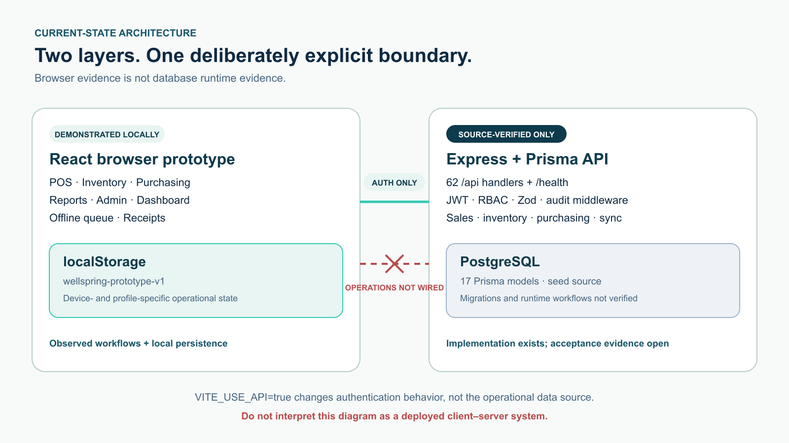
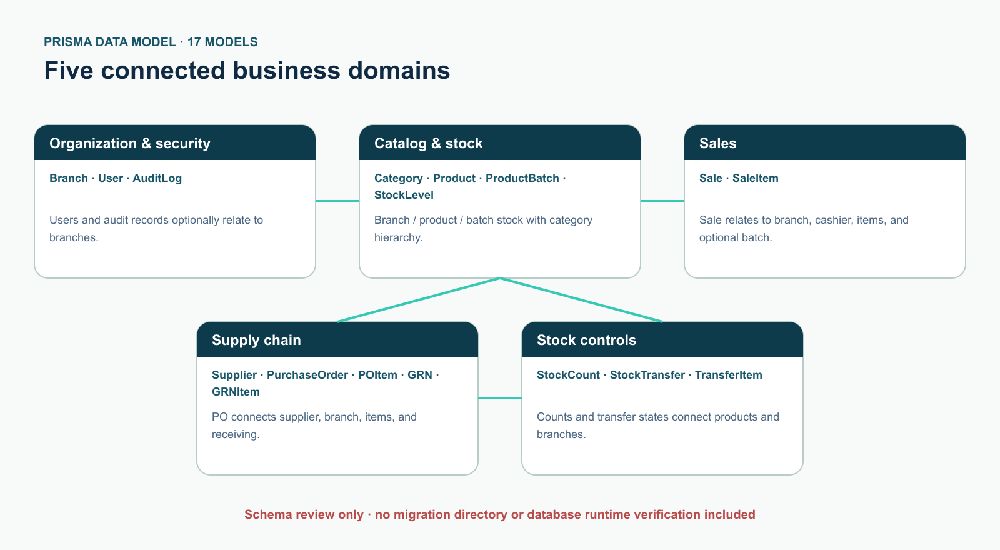

# WellSpring One — Technical Architecture, API, and Handover Guide

**Version:** 1.0 documentation baseline  
**Review date:** November 26, 2026  
**Audience:** Evaluators, maintainers, and the next implementation team  
**Status:** Source-verified architecture with a demonstrated browser prototype and a runtime-unverified API/database layer

> **Implementation boundary.** The React application demonstrates operational workflows with browser `localStorage`. Its POS, inventory, purchasing, reports, administration, dashboard, and Offline/Sync pages do not call the Express operational routes. `VITE_USE_API=true` changes authentication behavior only. Source inspection is not evidence of runtime integration, production security, or production acceptance.

## 1. System overview

WellSpring One is an npm-workspaces prototype for pharmacy sales, stock control, purchasing, reporting, and role-based administration.

| Workspace | Implementation | Current role |
|---|---|---|
| `apps/web` | React 18, TypeScript, Vite, React Router, Axios, TanStack Query, Recharts, Tailwind | Demonstrated local browser workflows and responsive UI |
| `apps/api` | Express, Prisma 5, PostgreSQL, JWT, bcrypt, Zod, Helmet, CORS, Morgan, rate limiting | Separate backend implementation; database runtime not verified |
| `packages/shared` | Roles, permission matrix, Zod models, API types, business constants | Shared TypeScript source used by web and API |

Node.js 20 or later is required. The supported local demonstration uses npm and the checked-in `package-lock.json`; the repository has no pnpm lockfile even though its CI currently uses pnpm.

### 1.1 Current-state architecture



1. A user interacts with the React application.
2. Operational prototype state is stored under `wellspring-prototype-v1` in that browser's `localStorage`.
3. Demo identities and local signup profiles use `wellspring-demo-accounts-v1`; the demo session uses `wellspring-demo-session`.
4. Offline mode is a manual UI state. Its queue is part of local prototype state; synchronization marks local entries complete only after the user restores the simulated connection and selects **Sync**.
5. The Express/Prisma/PostgreSQL layer exists in source. Browser operational pages do not consume it. API login can be selected with an environment flag, but session restoration is incomplete.

### 1.2 Repository map

```text
wellspring-pos/
├─ apps/
│  ├─ web/src/             React pages, contexts, calculations, demo data, tests
│  └─ api/
│     ├─ src/routes/       Express resource handlers
│     ├─ src/middleware/   JWT, RBAC, branch scope, audit, errors
│     ├─ prisma/           Schema and seed
│     └─ tests/            JWT and shared-permission unit tests
├─ packages/shared/src/    Shared roles, permissions, schemas, constants
├─ docs/                   Requirements, test plan, diagrams, screenshots, handover
├─ .github/workflows/      CI/CD draft requiring remediation
├─ docker-compose.yml      Deployment draft; not a verified startup path
└─ package.json            npm workspaces and root commands
```

## 2. Running the demonstrated browser prototype

### 2.1 Clean setup on another computer

```bash
git clone https://github.com/kurunami31/WellSpring1.git
cd WellSpring1
npm ci
npm run dev --workspace=@wellspring/web -- --host 127.0.0.1
```

Open `http://127.0.0.1:5173`. Use `admin@wellspring.ph` / `password123` for the administrator demonstration. All seeded browser identities use the same demo-only password. Do not use real customer, patient, employee, or payment information.

No API or PostgreSQL server is needed for the local browser demonstration. Do not set `VITE_USE_API=true` unless an API and database have intentionally been configured.

### 2.2 Reset and persistence

- **Offline & sync → Reset demo data** restores the shared local operational dataset.
- Local signup profiles are stored separately; a full clean-slate reset can be performed by clearing this site's browser storage.
- State is specific to one browser profile, origin, and device. It is not centralized across browsers or branches.
- Browser storage is editable and is neither a secure credential store nor a tamper-evident audit log.

## 3. Browser behavior and effective access

`apps/web/src/App.tsx` defines routes; `AppShell.tsx` applies matching navigation visibility. `SYSTEM_ADMIN` bypasses browser permission checks. These are usability controls, not security boundaries.

| Route | Demonstrated behavior | Effective browser access |
|---|---|---|
| `/login` | Seeded sign-in, local cashier signup, responsive overlay/switcher | Public; authenticated users redirect to dashboard |
| `/dashboard` | Revenue, transaction and stock metrics, trend, categories, fast movers, alerts, recent receipts | All authenticated roles; shortcuts are role-filtered |
| `/pos` | Search, cart, customer/payment selections, receipt, stock deduction | Cashier, supervisor, pharmacist, administrator; some other roles read-only; purchasing denied |
| `/inventory` | Search, stock/expiry filters, valuation, physical count with reason | Inventory staff, supervisor, administrator can adjust; selected roles read-only; cashier/purchasing denied |
| `/purchasing` | New PO, draft → sent approval, sent → received stock update | Purchasing drafts/receives; branch/head-office manager approves; inventory receives; administrator all |
| `/reports` | Today/seven-day/all sales reporting, charts, register, CSV export | Supervisor, inventory, branch/head-office manager, administrator; same local report for admitted roles |
| `/offline` | Manual connection simulator, queue view, manual sync, demo reset | All authenticated roles |
| `/admin` | Local staff table, add/activate/deactivate records, local audit events | Administrator manages; branch manager read-only; others denied |

### 3.1 Demonstrated business rules

- PHP currency, two-decimal display, positive integer quantities, and stock limits.
- Regular browser sales treat prices as VAT-exclusive and add 12% VAT.
- Browser senior/PWD sales apply a 20% discount to the after-item-discount subtotal and remove VAT.
- Card/e-wallet payments require a nonblank reference; installment shows an agreement field but contacts no provider.
- A cart containing prescription merchandise requires a checkbox attesting pharmacist review; no independent pharmacist/prescription verification occurs.
- Checkout decrements stock once and creates local sale, movement, and audit records. Receipt display and browser printing are available.
- The new-PO form creates one line; seeded POs can contain multiple lines. Browser receiving adds full listed quantities.
- Local signup creates a browser-only `CASHIER` at `WS01 · Davao Main`; later sign-in is case-insensitive by email.

### 3.2 Important demo-only behavior

- Local signup passwords are stored in plaintext in browser storage. The UI warns against using a real password.
- Administration creates staff-table records, not working credentials. Activation state does not control seeded demo authentication.
- Loyalty has no membership, points balance, or redemption workflow in the browser.
- There is no browser void/refund, transfer, supplier-maintenance, partial receiving, GRN document, invoice matching, or consolidated head-office dashboard.
- A single batch/expiry value is stored per browser product; automatic FEFO and multi-batch allocation are not demonstrated.
- Browser synchronization has no real connectivity detection, service worker, automatic retry, server acknowledgement, conflict resolution, or durable server upload.

## 4. API architecture and authorization

Except for public authentication handlers and `/health`, routes use Bearer JWT verification and a fresh active-user database lookup. Administrator bypasses permission checks. Zod validates major request bodies. Helmet, CORS, request logging, general rate limiting, and stricter login rate limiting are configured in source.

### 4.1 Endpoint inventory

The source contains **62 `/api` handlers plus `/health`**. This is a source inventory, not a runtime contract test or generated OpenAPI specification.

| Resource | Methods and paths | Effective guards |
|---|---|---|
| Authentication | `POST /api/auth/login`; `POST /api/auth/logout`; `GET /api/auth/me`; `POST /api/auth/change-password`; `POST /api/auth/refresh` | Login public/rate-limited; logout acknowledges client deletion; remaining handlers authenticated |
| Users | `GET /api/users`; `GET /api/users/:id`; `POST /api/users`; `PATCH /api/users/:id`; `DELETE /api/users/:id` | `admin:users`; delete deactivates |
| Branches | `GET /api/branches`; `GET /api/branches/:id`; `POST /api/branches`; `PATCH /api/branches/:id`; `DELETE /api/branches/:id` | `admin:config` |
| Products | `GET /api/products`; `GET /api/products/:id`; `POST /api/products`; `PATCH /api/products/:id`; `DELETE /api/products/:id`; `GET /api/products/categories/all` | Entire mount `inventory:read`, including mutations |
| Inventory queries | `GET /api/inventory/stock`; `GET /api/inventory/stock/:productId/:branchId`; `GET /api/inventory/counts`; `GET /api/inventory/transfers`; `GET /api/inventory/reorder-alerts` | `inventory:read` |
| Inventory actions | `POST /api/inventory/count`; `POST /api/inventory/transfers`; `POST /api/inventory/transfers/:id/approve`; `POST /api/inventory/transfers/:id/ship`; `POST /api/inventory/transfers/:id/receive` | Count `inventory:count`; transfers `inventory:transfer` |
| Sales | `GET /api/sales`; `GET /api/sales/:id`; `GET /api/sales/:id/receipt`; `POST /api/sales`; `POST /api/sales/:id/void`; `POST /api/sales/:id/refund` | Read `sales:read`; create/void/refund use corresponding permissions |
| Suppliers | `GET /api/purchasing/suppliers`; `GET /api/purchasing/suppliers/:id`; `POST /api/purchasing/suppliers`; `PATCH /api/purchasing/suppliers/:id`; `DELETE /api/purchasing/suppliers/:id` | Read `purchasing:read`; mutations `supplier:manage` |
| Purchase orders | `GET /api/purchasing/purchase-orders`; `GET /api/purchasing/purchase-orders/:id`; `POST /api/purchasing/purchase-orders`; `POST /api/purchasing/purchase-orders/:id/send` | Read `purchasing:read`; create/send `purchasing:create_po` |
| Receiving/invoice | `POST /api/purchasing/grns`; `GET /api/purchasing/grns`; `POST /api/purchasing/invoice-match` | GRN create `purchasing:grn`; GRN read `purchasing:read` OR `purchasing:grn`; match `purchasing:invoice_match` |
| Reports | `GET /api/reports/sales/branch`; `GET /api/reports/bir/sales`; `GET /api/reports/inventory/stock-on-hand`; `GET /api/reports/inventory/ageing`; `GET /api/reports/inventory/expiry`; `GET /api/reports/dashboard/consolidated` | Branch/BIR `reports:branch_sales`; inventory `reports:inventory`; consolidated `reports:consolidated` plus head-office/admin role check |
| Administration | `GET /api/admin/config`; `PATCH /api/admin/config`; `GET /api/admin/health`; `GET /api/admin/backup-status`; `GET /api/admin/audit` | Config/health/backup `admin:config`; audit `admin:audit` |
| Sync | `POST /api/sync/upload`; `GET /api/sync/status` | Authenticated; no operation-specific RBAC |
| Health | `GET /health` | Public status/timestamp; not a database health check |

### 4.2 API behavior established by source review

- Sale creation validates stock, selected batch expiry, and prescription boolean; calculates totals; creates sale/items; decrements stock; and writes audit records. It does not automatically select the earliest-expiry batch.
- Void/refund handlers restore stock and require reasons.
- Stock counts auto-adjust within tolerance. Larger variances remain unapproved, but no approval endpoint is present.
- Transfers implement pending/approved/shipped/received states and source/destination stock updates.
- GRN creation updates PO received quantities and status but does not create product batches or stock levels.
- Admin configuration PATCH echoes input; backup status returns generated placeholder values.
- Browser approval uses `purchasing:approve_po`, but API send uses `purchasing:create_po`; no API endpoint uses `purchasing:approve_po`.
- The consolidated report route is statically reachable for head-office/admin roles under the current mounts, but remains runtime-unverified and unused by the browser.

### 4.3 Suggested integration sequence

1. Add API/database contract tests before wiring browser pages.
2. Correct authorization, branch-isolation, tax, sync-idempotency, and audit-redaction defects.
3. Introduce versioned migrations and representative seed data.
4. Connect one vertical slice—authenticate, read catalog, complete sale, read receipt—to prove shared server state.
5. Connect inventory and purchasing with explicit branch scope and transaction boundaries.
6. Replace simulated offline completion with durable queued commands, idempotency keys, acknowledgements, conflict policy, and retry monitoring.
7. Add consolidated reporting and external integrations only after the core data path is accepted.

## 5. Data model

The Prisma schema defines **17 models**:

| Domain | Models and principal relationships |
|---|---|
| Organization/security | `Branch`, `User`, `AuditLog`; users and audit records optionally relate to branches |
| Catalog/stock | `Category`, `Product`, `ProductBatch`, `StockLevel`; category hierarchy, product batches, branch/product/batch stock |
| Sales | `Sale`, `SaleItem`; sale relates to branch/cashier and cascading items; item optionally relates to batch |
| Supply chain | `Supplier`, `PurchaseOrder`, `POItem`, `GRN`, `GRNItem`; PO relates to supplier/branch/items/GRNs |
| Controls | `StockCount`, `StockTransfer`, `TransferItem`; transfers relate to both branches and actor users |



Notable boundaries:

- The seed creates three branches, four categories, six products, one supplier, nine users, and 50 units per product per branch. The browser demo has a different dataset.
- The seed creates no `ProductBatch` records; batch-tracked products receive `batchId: null` stock. Seed data alone cannot demonstrate FEFO.
- There is no persistent stock-movement model despite a `StockMovementType` enum.
- Some IDs lack Prisma relations, including batch supplier ID, PO creator/approver IDs, stock-count approver, and sale prescription ID.
- There are no promotion, loyalty-account, payment-provider, accounting, or system-configuration models.
- No Prisma migration directory is included. Use versioned migrations before any shared or production database work.

## 6. Environment and database setup for future integration

The following is a **ready-to-run integration procedure, not an executed result**. PostgreSQL was unavailable during this submission's final QA.

```bash
cd apps/api
cp .env.example .env       # Windows: copy .env.example .env
# Set a unique DATABASE_URL and a strong JWT_SECRET in .env.
npm run db:generate --workspace=@wellspring/api
npm run db:push --workspace=@wellspring/api
npm run db:seed --workspace=@wellspring/api
npm run dev --workspace=@wellspring/api
```

For an intentional API-authentication experiment, configure the web app with `VITE_USE_API=true` and `VITE_API_URL=http://localhost:3001`, then restart Vite. Operational pages remain local. API session restoration must be corrected before relying on reload behavior.

Do not commit `.env`, real connection strings, passwords, access tokens, or production secrets. Use a secret manager in deployed environments.

## 7. Security and correctness register

These are source-review findings requiring remediation and verification, not claims that an exploit was executed.

| Priority | Finding | Required action |
|---|---|---|
| Critical | Operational browser data and local passwords are client-controlled; local audit is editable | Label demo accurately; use server-side identity, authorization, password hashes, and protected audit storage for production |
| High | Product mutations inherit `inventory:read`; sync lacks operation-specific RBAC | Enforce least privilege for every action and operation type; add deny-by-default tests |
| High | Several direct-ID handlers do not visibly verify returned entity branch, including sale/PO/transfer examples | Apply branch predicates inside every query/transaction and test cross-branch access |
| High | Sync validates `clientId` but does not persist/check it; retry can duplicate a sale | Add a unique idempotency record and atomic replay behavior; implement tested conflict policy |
| High | Audit middleware stores request/response bodies without visible redaction; user-creation passwords may enter audit JSON | Redact secrets and sensitive fields before logging; define retention/access controls |
| High | Frontend and API senior/PWD calculations differ | Obtain compliance review, implement one statutory rule, and reconcile receipts across paths |
| High | API session restoration does not call `getMe()` for a database identity | Restore from validated token/server identity; handle expiry and inactive users |
| Medium | GRN does not create stock/batch records; large stock-count variance lacks approval endpoint | Complete transactional receiving and variance workflows or explicitly remove unsupported claims |
| Medium | Demo administration does not govern actual login; local staff changes are cosmetic for authentication | Use one authoritative user store and enforce active state at authentication/authorization |
| Medium | Offline UI wording can imply server upload although none occurs | Retain explicit “simulation/local only” wording until real acknowledgements exist |

Use only synthetic data in the prototype. No RA 10173, BIR, payment, or production-security certification is asserted.

## 8. Build, test, CI, and dependency status

Final local results are detailed in [TEST_PLAN.md](TEST_PLAN.md):

- API: 4/4 tests in two files passed; web: 21/21 tests in three files passed.
- API, web, and shared production builds passed.
- Web ESLint passed. Root lint is not green because API/shared ESLint configuration is missing.
- Root `npm test` also reports that the shared workspace has no test script after the API/web tests complete.
- `npm audit --json` reported **4 moderate, 8 high, and 2 critical** dependency findings. No automatic force upgrade was applied.

CI requires handover remediation: it uses pnpm without a pnpm lockfile, root lint is not green, the **Web Tests** job only builds rather than running web tests, and staging deployment is an echo placeholder. Do not describe this workflow as a verified deployment pipeline.

`docker-compose.yml` references a missing `apps/web/Dockerfile`, does not set `VITE_USE_API=true`, contains example secrets, and includes an unused Redis service. npm setup is the reproducible browser-demo path; Compose is a draft.

## 9. Production roadmap and acceptance gates

| Stage | Deliverables | Exit evidence |
|---|---|---|
| 1. Stabilize foundation | Reproducible npm CI, lint configuration, migration baseline, dependency remediation plan | Clean install/build/test/lint; reviewed audit; rollback-safe migration |
| 2. Secure core API | Action/branch RBAC, session restoration, audit redaction, tax reconciliation, idempotent sync | API integration/security tests with PostgreSQL; cross-branch denial proof |
| 3. Integrate operations | Browser uses shared server catalog, sales, stock, purchasing, reports | End-to-end role workflows and two-client consistency proof |
| 4. Complete pharmacy controls | Multi-batch/FEFO, receiving/discrepancy, void/refund UI, stock movement ledger | Representative pharmacy UAT and reconciliation |
| 5. Offline and integrations | Durable queue, acknowledgements, conflicts, accounting/payment adapters | Fault injection, retry/replay tests, vendor sandbox certification |
| 6. Operate at scale | TLS, monitoring, backup/restore, deployment, training, support | PR-01–PR-06 measurements, recovery exercise, eight-branch UAT, compliance sign-off |

Production acceptance requires every mandatory RFP requirement, no critical UAT defects, reconciliation across eight branches and accounting, independent PR-01–PR-06 evidence, and approved privacy/BIR/support procedures. See [REQUIREMENTS.md](REQUIREMENTS.md) for measurable targets.

## 10. Handover checklist

- [ ] Clone with the URL above and run `npm ci` using Node.js 20+.
- [ ] Demonstrate the browser prototype without presenting local state as a server database.
- [ ] Keep demo credentials and sample data out of real operations.
- [ ] Review the source security register before exposing any API publicly.
- [ ] Establish PostgreSQL, migrations, API integration tests, and a single operational data path.
- [ ] Replace CI/CD and Compose drafts with tested, secret-safe workflows.
- [ ] Resolve dependency findings deliberately; retest rather than applying blind force upgrades.
- [ ] Preserve editable Markdown/DOCX/PPTX sources and regenerate PDFs after changes.
- [ ] Record future acceptance evidence in `TEST_PLAN.md`; never convert an unexecuted case into a pass by assertion.

## 11. Related submission artifacts

- [Submission guide and user workflows](SUBMISSION_GUIDE.md)
- [Requirements specification](REQUIREMENTS.md)
- [Test plan and QA evidence](TEST_PLAN.md)
- [Presentation narrative](PRESENTATION.md)
- [Presenter and live-demo script](PRESENTER_DEMO_SCRIPT.md)
- [RFP use-case planning artifact](USE_CASE_SPECIFICATION_RFP.docx)
- [Two-week Gantt planning artifact](GANTT_TWO_WEEK_PLAN.docx)
